# TryHackMe: Phishing Analysis Fundamentals

> **Track:** Phishing / Email Analysis
> **Difficulty:** Easy · **Time:** ~30 min
> **Room:** [Phishing Analysis Fundamentals](https://tryhackme.com/room/phishingemails1tryoe)
> **Focus:** How an email is built and delivered, how to read raw email headers, how to inspect an attachment, and how to spot a spoofed sender

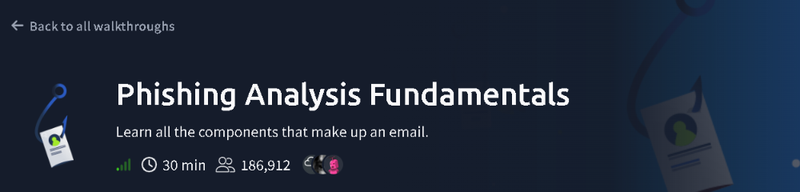

---

## Summary

Phishing analysis starts with understanding what an email actually is: a set of **headers** (the envelope and routing information) and a **body** (the content and attachments). This room covers how email moves between systems, then has you open real `.eml` / `.txt` message sources in Thunderbird and pull out the evidence an analyst would need.

| Part | What I did |
|---|---|
| Concepts | Email address anatomy, SMTP/IMAP and the role of DNS |
| Header analysis | Read the subject line and the `X-Originating-Ip` from a raw message source |
| Attachment analysis | Find an attachment's `Content-Type` and decode its base64 body |
| Spoofing analysis | Identify the impersonated brand, defang an IP, and read the authentication headers |
| Concepts | Business Email Compromise (BEC) |

---

## Step 1: Anatomy of an Email Address

An email address has two parts split by the `@` symbol: the **local part** (the mailbox) and the **domain**. For

```
hatsalesman@tryhatme.com
```

the domain is **`tryhatme.com`**.

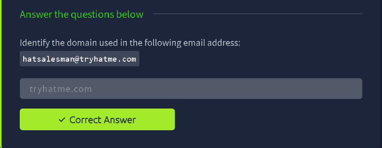

**Takeaway:** The domain is what you pivot on in an investigation (reputation lookups, WHOIS, blocklists), so being able to pull it out of an address is the first skill to have.

---

## Step 2: How Email Is Delivered

| Question | Answer |
|---|---|
| Protocol that **sends** mail from a client to a mail server | **SMTP** |
| Service used to look up the recipient domain's mail server | **DNS** (via the domain's MX records) |
| Protocol to read mail from multiple devices (phone and laptop) | **IMAP**, which keeps mail on the server so every device stays in sync |

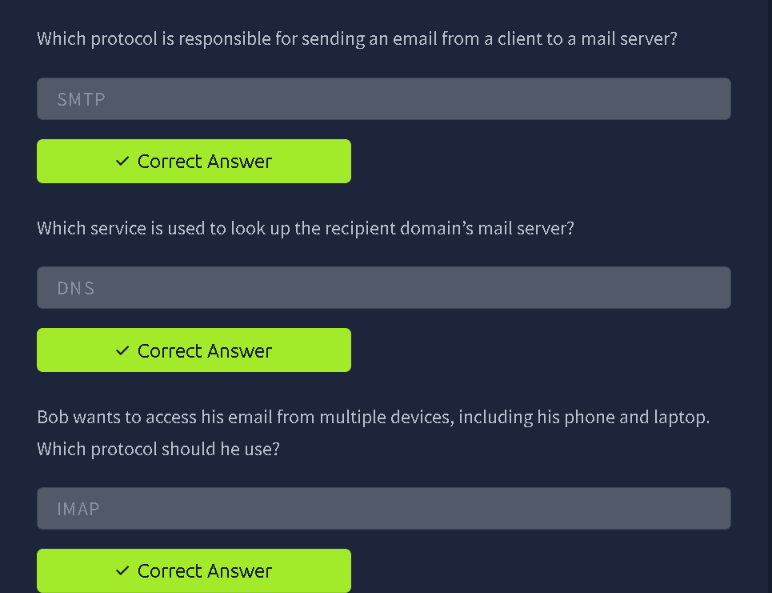

**Takeaway:** SMTP sends, DNS tells the sending server where to deliver, and IMAP (or POP3) is how a user reads it. IMAP syncs across devices, while POP3 typically downloads mail to a single device.

---

## Step 3: Reading Raw Headers (email1.eml)

The room provides sample emails in a Linux VM with **Thunderbird**. For each one, I opened it and viewed the **message source** (raw headers and body), which is what an analyst works from rather than the pretty rendered view.

### 3.1 Subject line

In the raw source, the `Subject:` header gives the full subject line:

> `Help protect your budget by protecting your home`

The same header block also shows the sender and recipient details (`From:` shows the display name "ADT Security Services" with a different underlying address, `To:` is `alexa@yahoo.com`), plus routing information such as the `Received:` and `DKIM-Signature:` lines.

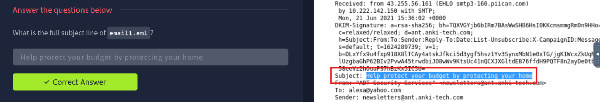

> **Why this matters:** The display name a recipient sees ("ADT Security Services") can be set to anything. The actual address and domain in the header are what you should check.

### 3.2 Originating IP

Further down the header block, the **`X-Originating-Ip`** header records the IP address the message was submitted from:

```
X-Originating-Ip: [43[.]255[.]56[.]161]
```

*(Defanged here so the IP isn't clickable or accidentally resolved.)*

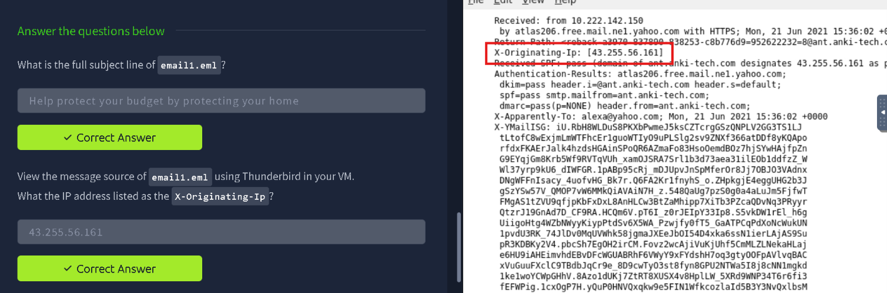

**Takeaway:** `X-Originating-Ip` is a quick pointer to where a message really came from. It can be checked against IP reputation and geolocation services.

---

## Step 4: Inspecting an Attachment (email2.txt)

The second sample is a saved message source (`email2.txt`) containing an attachment. Attachments are carried inside the email body as **MIME parts**, each with its own headers.

### 4.1 Find the Content-Type

Scrolling to the attachment's MIME part shows:

```
Content-Type: application/pdf; filename="zmqpalgh.pdf"
Content-Transfer-Encoding: base64
Content-Disposition: attachment; filename="zmqpalgh.pdf"
```

So the attachment's `Content-Type` is **`application/pdf`**, and its bytes are stored as a **base64** string (the block of text that follows).

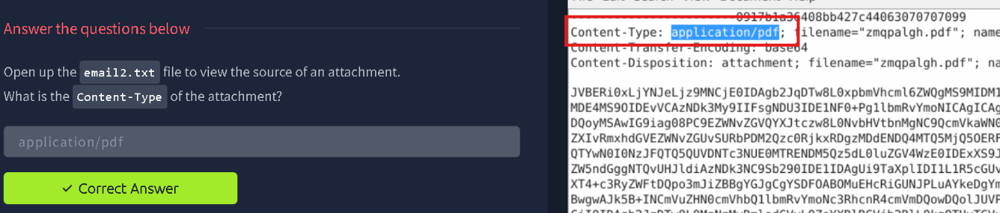

### 4.2 Decode the base64 body

Because the attachment is just base64 text, it can be turned back into the original file. The room points to two options: a **PDF converter** or **CyberChef**.

Using CyberChef, the workflow is:

1. Copy the base64 block from the message source.
2. Paste it into CyberChef's input.
3. Add the **From Base64** operation to the recipe.
4. Read the decoded output, which reveals the hidden value embedded in the PDF.

(On the command line, the equivalent is saving the block to a file and running `base64 -d attachment.b64 > attachment.pdf`, then opening the PDF.)

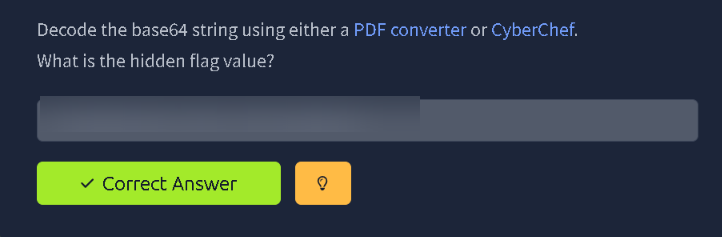

> 🔒 The flag is intentionally blurred. Decode the attachment yourself to find it.

**Takeaway:** Analysts routinely decode attachments from raw source to inspect them safely without opening them in a mail client. Never open an unknown attachment directly on your own machine.

---

## Step 5: Spotting a Spoofed Sender

The third sample is an order confirmation that looks like it came from a well-known retailer.

### 5.1 Identify the impersonated brand

The **From** line displays the name "**Home Depot**", but the address behind it is `support@teckbe.com`, a domain with no connection to Home Depot. The display name is what's being spoofed.

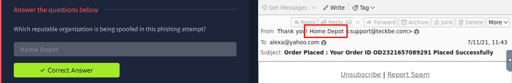

### 5.2 Extract and defang the originating IP

In this message's source, the `X-Originating-Ip` header is again the pointer to the real sender. When writing IPs into reports, tickets or chat, analysts **defang** them so they can't be clicked or auto-resolved, by replacing each dot with `[.]`:

```
103[.]234[.]236[.]83
```

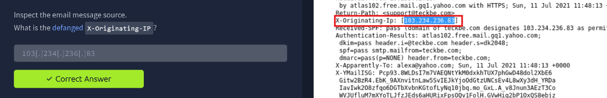

### 5.3 Read the authentication results

The `Authentication-Results` header is added by the **receiving mail server** and records how the message fared on email authentication checks. Here it was generated by the mail server **`atlas102.free.mail.gq1.yahoo.com`**, and it lists:

```
dkim=pass  header.i=@teckbe.com
spf=pass   smtp.mailfrom=teckbe.com
dmarc=pass (p=NONE) header.from=teckbe.com
```

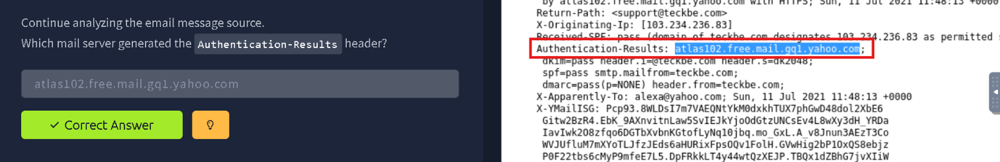

> **Important lesson:** SPF, DKIM and DMARC all **pass** here, yet the email is still phishing. These checks only prove the message really came from `teckbe.com`'s infrastructure. They say nothing about whether `teckbe.com` is a legitimate sender, or whether it matches the brand in the display name. Attackers can register their own domain, configure authentication correctly and still impersonate a brand. Note also `p=NONE`, which means the domain owner asks receivers not to take any action on failures.

---

## Step 6: Business Email Compromise (BEC)

The final concept: an attack that uses a **compromised (or spoofed) business email account** to trick employees into fraud, such as redirecting payments or sharing sensitive data, is called **Business Email Compromise (BEC)**.

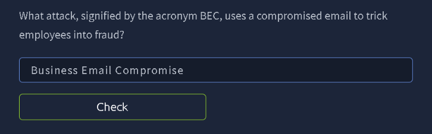

**Takeaway:** BEC often has no malicious link or attachment, so technical filters can miss it. Verifying unusual requests through a second channel is the main defence.

---

## Phishing Analysis Checklist (From This Room)

1. View the **raw message source**, not just the rendered email.
2. Compare the **display name** with the **actual address and domain**.
3. Check **`X-Originating-Ip`** and the **`Received:`** chain for the true origin.
4. Read **`Authentication-Results`** (SPF, DKIM, DMARC), but don't treat a "pass" as proof of legitimacy.
5. Inspect attachments via their **`Content-Type`**, and decode base64 parts in a safe tool such as CyberChef.
6. **Defang** every IOC (IPs, URLs, domains) before sharing it.

## Skills Practised

`Phishing Analysis` · `Email Header Analysis` · `SMTP / IMAP / DNS` · `SPF / DKIM / DMARC` · `Base64 Decoding (CyberChef)` · `IOC Defanging` · `Business Email Compromise`

---

*Room: [Phishing Analysis Fundamentals](https://tryhackme.com/room/phishingemails1tryoe) on TryHackMe.*
